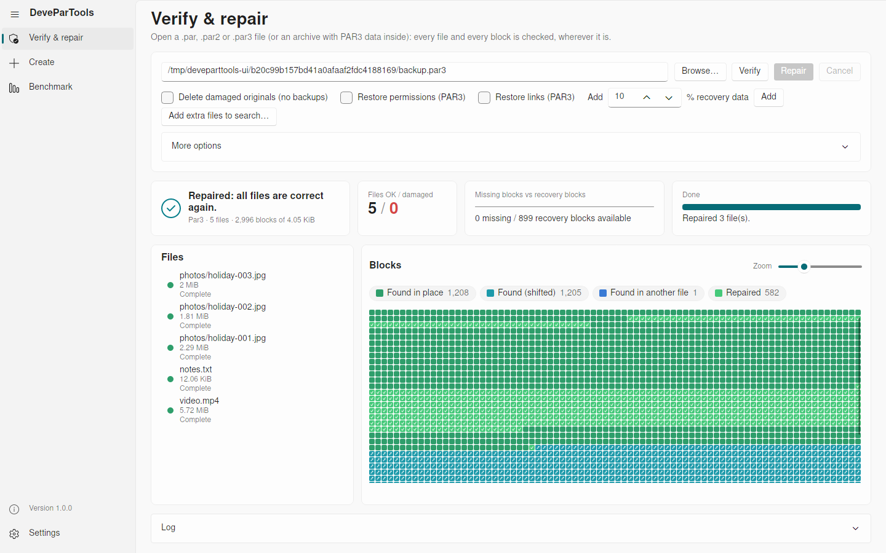

# DeveParTools


Create, verify and repair **PAR1, PAR2 and PAR3** recovery sets, the parity files that can rebuild damaged or
missing files. DeveParTools is a desktop app (Windows, Linux, macOS), a command-line tool and a .NET library. It is
fully managed C# with no native dependencies, and as fast as the native tools.

| Build | Coverage |
|:---:|:---:|
| [](https://github.com/devedse/DeveParTools/actions/workflows/githubactionsbuilds.yml) | [](https://codecov.io/gh/devedse/DeveParTools) |


## Features

- **All three PAR versions** for create, verify and repair:
  - PAR1 (`.par` / `.p01`)
  - PAR2 (`.par2`)
  - PAR3 (`.par3`): folders, FFT Reed-Solomon, deduplication, tail packing, permissions and links.
- **Compatible with the reference tools in both directions.** CI creates sets with DeveParTools and repairs them with
  [par2cmdline](https://github.com/Parchive/par2cmdline), [par2cmdline-turbo](https://github.com/animetosho/par2cmdline-turbo)
  and [par3cmdline](https://github.com/Parchive/par3cmdline), and the other way around.
- **Finds your data wherever it is.** Every block is located with a rolling checksum, so blocks are found in renamed files,
  in files where bytes were inserted or removed (data shifted), and in extra files you point it to. Only data that is
  really gone counts as missing.
- **See every block.** The app shows each block of the set in a grid, updated live while it scans and repairs: found,
  shifted, found in another file, damaged, missing, recoverable, being rebuilt, repaired.
- **Fast.**
  - GF(2^8) / GF(2^16) arithmetic with SSSE3, AVX2, AVX-512 and GFNI on x86, and NEON on ARM. The best kernel is
    picked at run time.
  - Multithreaded encoding and hashing.
  - PAR3's FFT Reed-Solomon code (a port of the Leopard algorithm) takes O(n log n) instead of O(n²).
  - BLAKE3 hashes up to 16 chunks at once with SIMD.
- **Grow a set later.** `extend` adds recovery blocks to an existing PAR2 or PAR3 set, also one made by par2cmdline
  or par3cmdline; the reference tools repair with the new blocks. For PAR3 Cauchy sets the coefficient convention is
  detected from the existing recovery data, and FFT sets grow up to the maximum chosen at creation (`--max-recovery`).
- **Archives that repair themselves ("PAR inside").** `insert` puts PAR3 recovery data inside a .zip, .7z or .rar.
  The archive keeps working in archive tools (Info-ZIP, 7-Zip, .NET's ZipArchive), can be verified and repaired like
  a PAR file, and `delete` restores the original bytes. It is compatible with par3cmdline's insert, delete, verify
  itself and repair itself commands.
- **Safe.** Stored file names cannot escape the target folder. Damaged files are kept as backups (`name.1`) unless
  you ask otherwise. PAR3 links and permissions are restored only on request.

## Download

Get the latest build from [Releases](https://github.com/devedse/DeveParTools/releases):

| | Windows | Linux | macOS |
|---|---|---|---|
| Desktop app | `DeveParTools-win-x64.zip` | `DeveParTools-linux-x64.tar.gz` | `DeveParTools-osx-arm64.tar.gz` |
| Command line (`devepar`) | `devepar-win-x64.zip` | `devepar-linux-x64.tar.gz`, `devepar-linux-arm64.tar.gz` | `devepar-osx-arm64.tar.gz` |

Both are single self-contained executables; no .NET installation is needed.

## The desktop app

| Verify after damage | After repair |
|---|---|
|  |  |
| **Create** | **Dark theme** |
|  |  |

**Verify & repair.** Open any `.par`, `.par2` or `.par3` file and every protected file is checked. The cards show the
outcome, how many files are damaged, and how many recovery blocks the repair needs compared with what is available.
**Repair** rebuilds the damaged files; the grid then turns the rebuilt blocks green with a check mark.

**The block grid.** One square per block, in file order. Large sets are grouped, and a group then shows the worst
state in it. Hover a square for details, click a file to highlight its blocks, and click a legend chip to hide that
state. Colour is never the only cue: states with similar colours also get a glyph.

| State | Meaning |
|---|---|
| Found in place | The block is where it belongs. |
| Found (shifted) ↗ | The block is in the right file, but at another offset (bytes were inserted or removed before it). Repair moves it. |
| Found in another file | The block was found in a different file (a renamed copy, or an extra file you added). |
| Damaged | The block's position exists, but its contents are wrong. |
| Missing | The block was not found anywhere. |
| Missing, recoverable | Missing or damaged, but there are enough recovery blocks to rebuild it. |
| Repairing / Repaired ✓ | Being rebuilt right now / rebuilt and verified. |
| Unrecoverable | Not enough recovery data. |

**Create.** Drop files or folders, pick the format and the redundancy, and see an estimate of the recovery data size.
PAR2 is the most compatible. PAR3 protects folder trees, is much faster for large sets thanks to the FFT code, and
can store permissions.

**Benchmark** shows the speed of every kernel on your machine. **Settings** sets threads, memory, the SIMD kernel
(to compare kernels) and the theme.

The screenshots come from the headless UI test in `DeveParTools.App.Tests`, which drives the real app through create,
damage, verify and repair.

## Command line

```text
devepar create  <output.par2|.par3|.par> <files/folders...> [options]
devepar verify  <parfile> [extra files...]
devepar repair  <parfile> [extra files...] [--purge]
devepar extend  <parfile> [extra files...] -c <count> | -r <percent>
devepar insert  <archive.zip|.7z|.rar> [-r <percent>]
devepar delete  <archive.zip|.7z|.rar>
devepar list    <parfile>
devepar bench | info
```

Examples:

```bash
devepar create photos.par2 photos/ -r 10                 # PAR2, 10% recovery data
devepar create backup.par3 projects/ -r 5 --code fft -n 4 # PAR3 with the FFT code, 4 recovery files
devepar verify photos.par2 --map                         # block map in the terminal
devepar repair photos.par2 ~/Downloads/IMG_0001.jpg      # also look for data in an extra file
devepar verify backup.par3 --json                        # NDJSON events for scripts and other UIs
devepar extend backup.par3 -r 5                          # add 5% more recovery data to an existing set
devepar insert photos.zip -r 3                           # the ZIP now carries recovery data for itself...
devepar repair photos.zip                                # ...so it can repair itself
devepar delete photos.zip                                # back to the original bytes
```

Common options:
- `--threads/-t`, `--memory/-m` (MiB)
- `--quiet/-q`
- `--json`: progress, log and result as one JSON object per line.

Create options:
- `--redundancy/-r`, `--recovery-count/-c`
- `--block-count/-b`, `--block-size/-s`
- `--volumes/-n`, `--uniform/-u`, `--limit/-l`
- `--first`, `--comment`, `--base/-B`, `--no-recurse`, `--format/-f`

PAR3-only create options:
- `--code auto|cauchy|fft`
- `--dedup`, `--no-tail-packing`, `--data/-D`
- `--unix-permissions`, `--fat-permissions`
- `--reproducible`, `--interleave/-i`, `--max-recovery`

Exit codes are the same as par2cmdline's, so existing scripts keep working:

| Code | Meaning |
|---|---|
| 0 | Success: all files are correct (verify), or the repair or create succeeded |
| 1 | Damaged, but repair is possible |
| 2 | Damaged, and repair is not possible |
| 3 | Invalid command-line arguments |
| 4 | Not enough critical data in the PAR files to verify |
| 5 | Repair failed |
| 6 | File I/O error |
| 7 | Logic error |
| 8 | Out of memory |

## Library

```csharp
using DeveParTools;

// Create (the extension picks the format; folders are fine)
ParClient.Create(new ParCreateRequest { Inputs = ["photos"], OutputPath = "photos.par2", RedundancyPercent = 10 });

// Verify and repair
var report = ParClient.Verify("photos.par2");
if (!report.AllFilesComplete && report.RepairPossible)
{
    var result = ParClient.Repair(report);
    Console.WriteLine(result.Message);
}
```

Pass an `OperationContext` to get progress, log lines, cancellation, a thread count and a memory budget. Its
`BlocksCreated` event hands you the live `BlockStateMap` that the app draws its grid from.

| Project | Contents |
|---|---|
| `DeveParTools.Core` | Galois fields and SIMD kernels, matrix inversion, linear combiner, FFT Reed-Solomon (Leopard), BLAKE3, CRC-32, CRC-64, rolling block scanner, block state model |
| `DeveParTools.Par1` / `.Par2` / `.Par3` | Each format: packets, create, verify, repair |
| `DeveParTools` | `ParClient`: one API for all formats (detection, create, verify, repair) and `ParBenchmark` |
| `DeveParTools.Cli` | `devepar` |
| `DeveParTools.App` | The Avalonia desktop app |

The hard parts are documented in the source with worked examples:
- Gauss-Jordan inversion over GF(2^8): `GfMatrix`.
- PAR2's constants: `Par2Math`.
- The FFT code: `LeopardCodec`.
- BLAKE3's tree and SIMD transposition: `Blake3`, `Blake3Simd`.
- CRC combining: `Crc64Iso.Combine`.
- The rolling block search: `BlockScanner`.

## Performance

`devepar bench` on a 4-core AVX2 virtual machine (no AVX-512 or GFNI):

| | GB/s |
|---|---|
| GF(2^16) multiply-add, AVX2 (PAR2/PAR3 inner loop) | 27.7 |
| GF(2^8) multiply-add, AVX2 | 51.2 |
| BLAKE3, 1 thread / 4 threads | 1.4 / 3.1 |
| FFT Reed-Solomon encode, 1000+100 blocks, 4 threads | 2.7 |

## Building and testing

```bash
dotnet build DeveParTools.slnx
dotnet test --project DeveParTools.Core.Tests     # also .Par1.Tests, .Par2.Tests, .Par3.Tests, .Tests
dotnet run --project DeveParTools.App.Tests -- out # headless UI checks + screenshots
```

**Interop tests.** `DeveParTools.InteropTests` runs against the reference tools when these environment variables
point to them: `DEVEPARTOOLS_PAR2CMDLINE`, `DEVEPARTOOLS_PAR2TURBO`, `DEVEPARTOOLS_PAR3CMDLINE`. Without them the
tests are skipped.

**Every SIMD path is tested, even without the hardware.** CI also runs the Core tests under
[Intel SDE](https://www.intel.com/software/sde), which emulates Sapphire Rapids (AVX-512 + GFNI), Alder Lake
(AVX2 + GFNI), Skylake-X (AVX-512 without GFNI) and Sandy Bridge (SSSE3 only). ARM64 runners cover NEON. Codecov
merges the coverage of all runs. To run under SDE yourself:

```bash
DOTNET_EnableWriteXorExecute=0 DOTNET_EnableDiagnostics_IPC=0 DOTNET_EnableDiagnostics_Debugger=0 \
  sde64 -spr -- dotnet exec DeveParTools.Core.Tests.dll
```

## License

MIT, see [LICENSE](LICENSE). Third-party notices (the Leopard-RS algorithm port, Fluent UI icons, test vectors) are
in [THIRD_PARTY_NOTICES.md](THIRD_PARTY_NOTICES.md).
