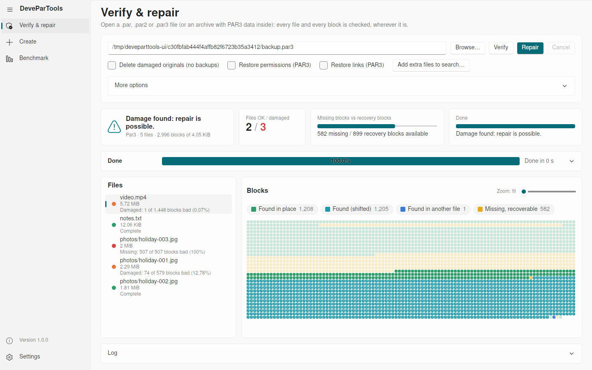
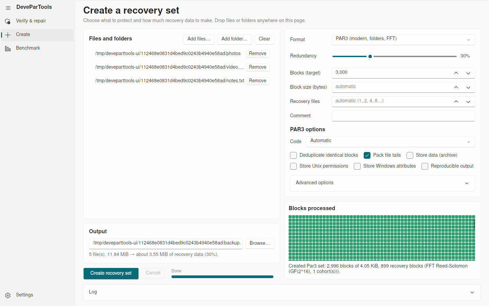
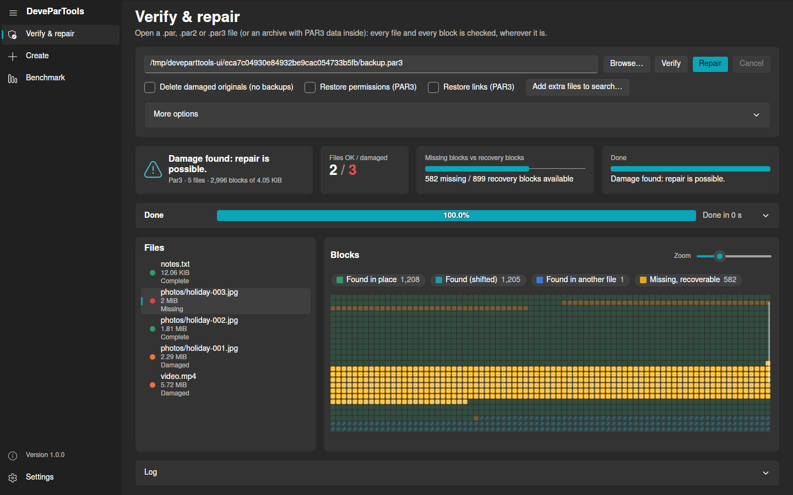

# DeveParTools


Create, verify and repair **PAR1, PAR2 and PAR3** recovery sets, the parity files that can rebuild damaged or
missing files. DeveParTools is a desktop app (Windows, Linux, macOS), a command-line tool and a .NET library. It is
fully managed C# with no native dependencies, and as fast as the native tools.

| Build | Coverage |
|:---:|:---:|
| [](https://github.com/devedse/DeveParTools/actions/workflows/githubactionsbuilds.yml) | [](https://codecov.io/gh/devedse/DeveParTools) |



## Features

- **All three PAR versions** for create, verify and repair:
  - PAR1 (`.par` / `.p01`)
  - PAR2 (`.par2`)
  - PAR3 (`.par3`): folders, FFT Reed-Solomon, deduplication, tail packing, permissions and links.
- **Compatible with the reference tools in both directions.** CI creates sets with DeveParTools and repairs them with
  [par2cmdline](https://github.com/Parchive/par2cmdline), [par2cmdline-turbo](https://github.com/animetosho/par2cmdline-turbo)
  and [par3cmdline](https://github.com/Parchive/par3cmdline), and the other way around.
- **Finds your data wherever it is.** Every block is located with a rolling checksum, so blocks are found in renamed files,
  in files where bytes were inserted or removed (data shifted), and in extra files you point it to. Only data that is
  really gone counts as missing.
- **See every block.** The app shows each block of the set in a grid, updated live while it scans and repairs: found,
  shifted, found in another file, damaged, missing, recoverable, being rebuilt, repaired.
- **Fast.**
  - GF(2^8) / GF(2^16) arithmetic with SSSE3, AVX2, AVX-512 and GFNI on x86, and NEON on ARM. The best kernel is
    picked at run time.
  - Multithreaded encoding and hashing.
  - PAR3's FFT Reed-Solomon code (a port of the Leopard algorithm) takes O(n log n) instead of O(n²).
  - BLAKE3 hashes up to 16 chunks at once with SIMD.
- **Grow a set later.** `extend` adds recovery blocks to an existing PAR2 or PAR3 set, also one made by par2cmdline
  or par3cmdline; the reference tools repair with the new blocks. For PAR3 Cauchy sets the coefficient convention is
  detected from the existing recovery data, and FFT sets grow up to the maximum chosen at creation (`--max-recovery`).
- **Archives that repair themselves ("PAR inside").** `insert` puts PAR3 recovery data inside a .zip, .7z or .rar.
  The archive keeps working in archive tools (Info-ZIP, 7-Zip, .NET's ZipArchive), can be verified and repaired like
  a PAR file, and `delete` restores the original bytes. It is compatible with par3cmdline's insert, delete, verify
  itself and repair itself commands.
- **Safe.** Stored file names cannot escape the target folder. Damaged files are kept as backups (`name.1`) unless
  you ask otherwise. PAR3 links and permissions are restored only on request.

## Download

Get the latest build from [Releases](https://github.com/devedse/DeveParTools/releases):

| | Windows | Linux | macOS |
|---|---|---|---|
| Desktop app (`deveparui`) | `deveparui-win-x64.zip` | `deveparui-linux-x64.tar.gz` | `deveparui-osx-arm64.tar.gz` |
| Command line (`devepar`) | `devepar-win-x64.zip` | `devepar-linux-x64.tar.gz`, `devepar-linux-arm64.tar.gz` | `devepar-osx-arm64.tar.gz` |

Each archive holds one self-contained executable, `deveparui` (`deveparui.exe` on Windows) or `devepar`; no .NET
installation is needed. Both are trimmed (code the app never uses is left out) and ReadyToRun (compiled ahead of
time, so they start quickly; the JIT still optimizes the hot loops for your CPU's AVX2, AVX-512, GFNI or NEON).
The desktop app shows its window in about a third of a second.

### Updating

Both programs update themselves from these releases (see [Updates](#updates)):

- **Desktop app:** when a new version is out, a banner offers it. **Update…** shows the download, extraction and
  installation progress, then restarts DeveParTools. **Settings > Updates** has **Check now** and a switch for the
  automatic check.
- **Command line:** after a command, a line tells you when a new version is out. `devepar update` installs it, and
  `devepar update --check` only checks.

## The desktop app

| Verify after damage | After repair |
|---|---|
|  |  |
| **Create** | **Dark theme** |
|  |  |

**Verify & repair.** Open any `.par`, `.par2` or `.par3` file and every protected file is checked. The cards show the
outcome, how many files are damaged, and how many recovery blocks the repair needs compared with what is available.
**Repair** rebuilds the damaged files; the grid then turns the rebuilt blocks green with a check mark.

**The block grid.** One square per block, in file order. Large sets are grouped, and a group then shows the worst
state in it. Hover a square for details, click a file to highlight its blocks, and click a legend chip to hide that
state. Colour is never the only cue: states with similar colours also get a glyph.

| State | Meaning |
|---|---|
| Found in place | The block is where it belongs. |
| Found (shifted) ↗ | The block is in the right file, but at another offset (bytes were inserted or removed before it). Repair moves it. |
| Found in another file | The block was found in a different file (a renamed copy, or an extra file you added). |
| Damaged | The block's position exists, but its contents are wrong. |
| Missing | The block was not found anywhere. |
| Missing, recoverable | Missing or damaged, but there are enough recovery blocks to rebuild it. |
| Repairing / Repaired ✓ | Being rebuilt right now / rebuilt and verified. |
| Unrecoverable | Not enough recovery data. |

**Create.** Drop files or folders and pick the format. Every number shown is what will actually be written:
- **Blocks:** a slider (from 1 block to the format's maximum) and a count box set the number of blocks; the block
  size box sets the size instead. Both always show the actual count and size, for example 1,998 blocks when you
  asked for 2,000, because every file is rounded up to whole blocks.
- **Recovery:** the redundancy slider and the recovery block box are linked in the same way.
- **Recovery files:** growing (1, 2, 4, 8…), equal, or never larger than the largest input file, with an optional
  file count.
- **Summary:** the exact size of every file that will be written (index and recovery files, including all
  checksums and copies of the file list), the recovery data in it, the efficiency (how much of what is written
  protects your data; tiny blocks mostly write overhead), how many missing files can be rebuilt completely, the code,
  and errors or warnings such as PAR2's 32,768-block limit. Every option has a tooltip that explains it.
- **Default format:** PAR3.

The file list shows the size and blocks of every file and folder. PAR2 is the most compatible. PAR3 protects folder
trees, is much faster for large sets thanks to the FFT code, and can store permissions. **Advanced options** has the
first block number, the base folder, whether to include subfolders, and for PAR3 the maximum number of recovery
blocks of an FFT set, the interleave and the Cauchy coefficients.

**Progress.** Every operation lists all its steps before it starts: each with its own bar and percentage, its
estimated share of the work, and a tooltip saying what it does (for example that the recovery files are created at
full size when encoding starts and filled in during it). A total bar shows the percentage, the time left and the
time spent. Verify lists the files as soon as they are being checked, with how much of each is checked and how many
of its blocks are bad; files are checked in parallel. The block grid's zoom starts at "fit", which follows the window
size.

**Blocks.** The block slider stops at 32,768 blocks: up to there any lost blocks can be rebuilt as long as there are
as many recovery blocks. For PAR3, "Allow more than 32,768 blocks" goes further and explains the cost: the FFT code
then repairs per interleaved group, every block adds checksums to every PAR file, and verify and repair take longer.
Creating a set over an earlier one with the same name asks first and removes the old files, so they are not mixed up.

Every option and button has a tooltip.

**More options** on the Verify page sets the folder that holds the protected files, and the details of adding
recovery data: an exact count, the first block number, the number of files and their name. An archive with recovery
data inside gets a **Remove recovery data** button, which restores its original bytes.

**Benchmark** shows the speed of every kernel on your machine (buffer size and time per test are adjustable). **Settings** sets threads, memory, the SIMD kernel
(to compare kernels) and the theme.

**File associations (Windows and Linux).** A switch in Settings makes `.par`, `.par2` and `.par3` files (and PAR1
volumes `.p01`, `.p02`, …) open in DeveParTools when you double-click them, for your account only. On Windows the
types are also listed under "Open with" and in Settings > Default apps. If you already chose another program for a
type, Windows doesn't let an app change that; the app tells you which types are affected and opens the Default apps
page, where you can pick DeveParTools. On Linux it adds a desktop entry and MIME types, and sets the defaults in
`~/.config/mimeapps.list`. Turning the switch off gives the files back to the program they had before.

**Explorer context menu (Windows).** A switch in Settings adds two entries to the Explorer context menu:
- "Create recovery set with DeveParTools" on files and folders. A multi-selection opens one Create window with all
  the selected items, started once: the entry is a COM drop target, so Explorer hands over the whole selection in
  one go. A plain command line would make Explorer start the program once per selected item, one after another,
  and Explorer stays frozen until it has started them all.
- "Verify with DeveParTools" on `.par`, `.par2` and `.par3` files. It doesn't change which program opens them by
  default.

The entries are registered for your Windows account only, so no administrator rights are needed. Windows 11 shows
them under "Show more options". If you move the app, the entries follow it the next time it starts. Turn the switch
off before you delete the app.

The screenshots come from the headless UI test in `DeveParTools.App.Tests`, which drives the real app through create,
damage, verify and repair.

## Command line

```text
devepar create  <output.par2|.par3|.par> <files/folders...> [options]
devepar verify  <parfile> [extra files...]
devepar repair  <parfile> [extra files...] [--purge]
devepar extend  <parfile> [extra files...] -c <count> | -r <percent>
devepar insert  <archive.zip|.7z|.rar> [-r <percent>]
devepar delete  <archive.zip|.7z|.rar>
devepar list    <parfile>
devepar bench | info
devepar update  [--check]
```

Examples:

```bash
devepar create photos.par2 photos/ -r 10                 # PAR2, 10% recovery data
devepar create backup.par3 projects/ -r 5 --code fft -n 4 # PAR3 with the FFT code, 4 recovery files
devepar verify photos.par2 --map                         # block map in the terminal
devepar repair photos.par2 ~/Downloads/IMG_0001.jpg      # also look for data in an extra file
devepar verify backup.par3 --json                        # NDJSON events for scripts and other UIs
devepar extend backup.par3 -r 5                          # add 5% more recovery data to an existing set
devepar insert photos.zip -r 3                           # the ZIP now carries recovery data for itself...
devepar repair photos.zip                                # ...so it can repair itself
devepar delete photos.zip                                # back to the original bytes
devepar update                                           # install the latest release over this devepar
```

Common options:
- `--threads/-t`, `--memory/-m` (MiB)
- `--quiet/-q`
- `--json`: progress, log and result as one JSON object per line.

Create options:
- `--redundancy/-r`, `--recovery-count/-c`
- `--block-count/-b`, `--block-size/-s`: blocks are at most 64 MiB (for sets beyond 2 TiB, the size 32,768 blocks
  need), because verifying and repairing hold whole blocks in memory. Asking for fewer blocks than that gives more.
- `--volumes/-n`, `--uniform/-u`, `--limit/-l`
- `--first`, `--comment`, `--base/-B`, `--no-recurse`, `--format/-f`

PAR3-only create options:
- `--code auto|cauchy|fft`
- `--dedup`, `--no-tail-packing`
- `--data/-D` (rarely needed): also stores a full copy of the files in the set (`.part…par3` files), so the set alone
  can recreate them after the originals are gone, like a zip that can repair itself. Use it only when the PAR files
  replace the originals (an archive you will not touch, files you send). Next to files you keep, it only adds a
  second full copy.
- `--unix-permissions`, `--fat-permissions`
- `--reproducible`, `--interleave/-i`, `--max-recovery`

Exit codes are the same as par2cmdline's, so existing scripts keep working:

| Code | Meaning |
|---|---|
| 0 | Success: all files are correct (verify), or the repair or create succeeded |
| 1 | Damaged, but repair is possible |
| 2 | Damaged, and repair is not possible |
| 3 | Invalid command-line arguments |
| 4 | Not enough critical data in the PAR files to verify |
| 5 | Repair failed |
| 6 | File I/O error |
| 7 | Logic error (also: an update could not be checked or installed) |
| 8 | Out of memory |

## Updates

**Checking.** The programs ask GitHub's public API for the latest release
(`GET https://api.github.com/repos/devedse/DeveParTools/releases/latest`, no account). That is at most once a day: the
answer is kept in `update-check.txt` in the local app-data folder and shared by both programs. The request carries
only the program's name and version (`User-Agent: DeveParTools/1.0.40`).

- **Command line.** The check runs in the background while a command works, and a command never waits more than 2.5
  seconds for it. There is no check with `--json` or `--quiet`, when standard error is redirected, in CI (`CI` set),
  or with `DEVEPAR_NO_UPDATE_CHECK=1`.
- **Desktop app.** The check runs when the window opens, unless it is turned off in Settings.
- **Development builds** (version 1.0.0, or a build folder with its `.dll` files) never check by themselves and do not
  replace themselves.

**Installing.** The new version is downloaded into the program's own folder and checked against the SHA-256 that
GitHub publishes for every release file. Then:

- `devepar` renames itself to `devepar.old`, moves the new program into place and exits.
- `deveparui` starts the new program from the folder it was extracted to and exits. The new copy waits for it to close,
  copies itself over `deveparui` and starts it.

Why the app hands over instead of swapping itself: a single-file .NET program reads parts of itself from its file as
it first needs them, so it must not keep running once its file is a different version. Renaming a running program is
allowed on Windows (overwriting it is not). If putting the new file in place fails, the old one is put back. Leftovers
(`.old`, the download, the extract folder) are removed at the next start.

The program needs write access to its own folder. For `/usr/local/bin` or `Program Files`, run `sudo devepar update`
(or as administrator), or download the release by hand.

## Library

```csharp
using DeveParTools;

// Create (the extension picks the format; folders are fine)
ParClient.Create(new ParCreateRequest { Inputs = ["photos"], OutputPath = "photos.par2", RedundancyPercent = 10 });

// Verify and repair
var report = ParClient.Verify("photos.par2");
if (!report.AllFilesComplete && report.RepairPossible)
{
    var result = ParClient.Repair(report);
    Console.WriteLine(result.Message);
}
```

Pass an `OperationContext` to get progress, log lines, cancellation, a thread count and a memory budget. Its
`BlocksCreated` event hands you the live `BlockStateMap` that the app draws its grid from.

| Project | Contents |
|---|---|
| `DeveParTools.Core` | Galois fields and SIMD kernels, matrix inversion, linear combiner, FFT Reed-Solomon (Leopard), BLAKE3, CRC-32, CRC-64, rolling block scanner, block state model |
| `DeveParTools.Par1` / `.Par2` / `.Par3` | Each format: packets, create, verify, repair |
| `DeveParTools` | `ParClient`: one API for all formats (detection, create, verify, repair) and `ParBenchmark` |
| `DeveParTools.Cli` | `devepar` |
| `DeveParTools.App` | The Avalonia desktop app (`deveparui`) |

The hard parts are documented in the source with worked examples:
- Gauss-Jordan inversion over GF(2^8): `GfMatrix`.
- PAR2's constants: `Par2Math`.
- The FFT code: `LeopardCodec`.
- BLAKE3's tree and SIMD transposition: `Blake3`, `Blake3Simd`.
- CRC combining: `Crc64Iso.Combine`.
- The rolling block search: `BlockScanner`.
- Keeping the encoder's data in the CPU caches, and the kernels' own data layout: `LinearCombiner`, `Gf16Kernels.Prepare`.

## Performance

`devepar bench` on a 4-core AVX2 virtual machine (no AVX-512 or GFNI):

| | GB/s |
|---|---|
| GF(2^16) multiply-add, AVX2 (PAR2/PAR3 inner loop) | 43 |
| GF(2^8) multiply-add, AVX2 | 51.2 |
| BLAKE3, 1 thread / 4 threads | 1.4 / 3.1 |
| FFT Reed-Solomon encode, 1000+100 blocks, 4 threads | 2.7 |

Creating PAR2 with 2,000 input and 2,000 recovery blocks of 256 KiB on the same machine: 7.8 s
(par2cmdline-turbo: 7.3 s). How the encoder keeps the CPU busy instead of waiting for memory is described in
`LinearCombiner`.

## Building and testing

```bash
dotnet build DeveParTools.slnx
dotnet test --project DeveParTools.Core.Tests     # also .Par1/.Par2/.Par3/.Updates/.Cli.Tests, .Tests
dotnet run --project DeveParTools.App.Tests -- out # headless UI checks + screenshots

# Release builds, as CI makes them (use win-x64, linux-arm64, osx-arm64, ... for other systems)
dotnet publish DeveParTools.App -c Release -r linux-x64 --self-contained -p:PublishSingleFile=true \
  -p:IncludeNativeLibrariesForSelfExtract=true -p:PublishTrimmed=true -p:PublishReadyToRun=true
dotnet publish DeveParTools.Cli -c Release -r linux-x64 --self-contained -p:PublishSingleFile=true \
  -p:PublishTrimmed=true -p:PublishReadyToRun=true
```

**Updates against a local server.** Set `DEVEPARTOOLS_UPDATE_API=http://127.0.0.1:8765` and serve
`repos/devedse/DeveParTools/releases/latest` (GitHub's JSON) plus the files it links to. The programs then update from
there, which tests the whole flow, restart included, without publishing a release.

**Trimming.** Trim warnings fail the build. The desktop app's few harmless ones (in packages, for code the app
never runs) are suppressed one method at a time in `DeveParTools.App/ILLink.Suppressions.xml`, with the reason for
each. CI runs the UI checks on a trimmed build, so anything trimming removes that the app does need shows up there.

**Interop tests.** `DeveParTools.InteropTests` runs against the reference tools when these environment variables
point to them: `DEVEPARTOOLS_PAR2CMDLINE`, `DEVEPARTOOLS_PAR2TURBO`, `DEVEPARTOOLS_PAR3CMDLINE`. Without them the
tests are skipped.

**Every SIMD path is tested, even without the hardware.** CI also runs the Core tests under
[Intel SDE](https://www.intel.com/software/sde), which emulates Sapphire Rapids (AVX-512 + GFNI), Alder Lake
(AVX2 + GFNI), Skylake-X (AVX-512 without GFNI) and Sandy Bridge (SSSE3 only). ARM64 runners cover NEON. Codecov
merges the coverage of all runs. To run under SDE yourself:

```bash
DOTNET_EnableWriteXorExecute=0 DOTNET_EnableDiagnostics_IPC=0 DOTNET_EnableDiagnostics_Debugger=0 \
  sde64 -spr -- dotnet exec DeveParTools.Core.Tests.dll
```

## License

MIT, see [LICENSE](LICENSE). Third-party notices (the Leopard-RS algorithm port, Fluent UI icons, test vectors) are
in [THIRD_PARTY_NOTICES.md](THIRD_PARTY_NOTICES.md).
